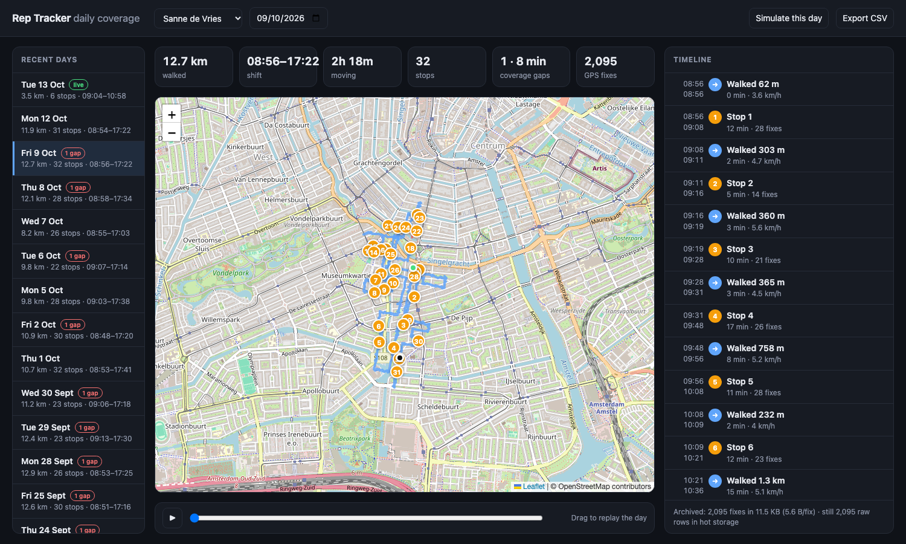

# Rep Tracker: continuous route tracking for field sales reps

A Laravel 13 API (plus a small Leaflet viewer) that ingests the GPS fixes from sales reps' phones, keeps a complete record of every rep's movement, and keeps years of that history cheap to store and fast to query.



**In short:**

- **No data loss.** Uploads are idempotent and accepted per fix. The archive marker is written in the same transaction as the points. Every archive is verified with a checksum before raw data may be removed, and late uploads are merged into the archive at any time.
- **Storage.** Raw fixes stay in a monthly-partitioned "hot" table for 90 days. Each finished rep-day is also compacted, **losslessly**, into one row of 5.6 bytes per fix, against 69 bytes per fix as an InnoDB row. That is about 12× smaller, measured on the seeded data. Expired months are removed with an instant `DROP PARTITION`.
- **Reading.** Any day, today or four years ago, comes from the same API. A reader merges both tiers, so callers never need to know where the data lives.

---

## Quick start (Docker)

Requirements: Docker with Compose. Nothing else is needed on the host.

```bash
git clone <this repo> rep-tracker && cd rep-tracker
docker compose up -d --build              # app on :8000, MySQL 8.4, scheduler
docker compose logs -f app                # wait for "Server running on [http://0.0.0.0:8000]"
docker compose exec app php artisan db:seed
```

Open **http://localhost:8000**.

The seeder creates 4 reps with 3 weeks of simulated shifts in Amsterdam, plus today's shift so far. It also adds one week from three years ago that has already been archived and pruned, so it is served from cold storage only (pick that date in the date picker). On a laptop it takes about 20 seconds.

> Ports: set `APP_PORT` / `DB_FORWARD_PORT` if 8000 / 33061 are taken.
> `docker/start.sh` copies `.env.example` → `.env`, generates the app key and runs migrations on first boot.

### Tests

```bash
docker compose exec app php artisan test          # in-memory SQLite (partition test is skipped)
docker compose exec app composer test:mysql       # the same suite against MySQL, including partitioning
```

### Useful commands

| Command | What it does |
|---|---|
| `php artisan tracking:simulate --rep=1 --from=2026-09-01 --to=2026-09-30` | Generate realistic shifts and push them through the real ingestion path |
| `php artisan tracking:archive` | Archive finished rep-days from the pending queue (runs hourly) |
| `php artisan tracking:archive --rebuild` | Re-compute every archive, e.g. after changing the timeline algorithm |
| `php artisan tracking:prune [--dry-run]` | Drop raw data older than the hot window, once it is verified archived (runs daily) |
| `php artisan tracking:partitions` | Create upcoming monthly partitions and list them with sizes (runs daily) |
| `php artisan tracking:storage` | Measured bytes per fix, hot against archived |
| `php artisan tracking:create-rep "Name" email@x.nl` | Register a rep and print their device token |

---

## API

All endpoints are under `/api/v1`. Dates are local calendar days in the rep's timezone (`Y-m-d`). Timestamps are returned in ISO-8601 with the rep's offset.

### Device → server

`POST /locations` with `Authorization: Bearer <device token>`

```json
{
  "points": [
    { "recorded_at": "2026-10-13T09:00:00Z", "lat": 52.3745123, "lng": 4.8810456,
      "accuracy": 8, "speed": 1.4, "heading": 90, "battery": 88 }
  ]
}
```

- Up to 1,000 fixes per request. `recorded_at` may be ISO-8601 or a unix timestamp. `accuracy` is in metres and `speed` in m/s; both are optional, as are `heading` and `battery`.
- The rep is taken from the token, so a phone can only ever write its own track.
- Response `201`:

```json
{ "received": 3, "stored": 2, "duplicates": 0,
  "rejected": [{ "index": 1, "reason": "lat must be between -90 and 90." }],
  "days": ["2026-10-13"] }
```

  A `2xx` means every fix not listed in `rejected` is durably stored (or was already stored by an earlier attempt), so the phone may delete the whole batch from its buffer.

### Management (read)

| Endpoint | Returns |
|---|---|
| `GET /reps` | Reps |
| `GET /reps/{rep}/days?from=&to=` | Per-day summaries (distance, active hours, stops, coverage gaps). Archived days come from pre-computed columns; days still pending are analysed live |
| `GET /reps/{rep}/days/{date}` | Summary, **timeline** (`move` / `stop` / `gap` entries), and where the data currently lives |
| `GET /reps/{rep}/days/{date}/track?simplify=3` | GeoJSON for a map: route per move, stops as points, gaps as straight connectors. `simplify` is the Douglas-Peucker tolerance in metres, applied only for drawing; `0` = every fix |
| `GET /reps/{rep}/days/{date}/points[?format=csv]` | Every stored fix at full fidelity, as JSON or CSV |
| `POST /reps/{rep}/days/{date}/simulate` | Dev helper: generate a shift for that day and upload it through the ingestion service (disable with `TRACKING_SIMULATOR_ENABLED=false`) |

Example timeline entries:

```json
{ "type": "move", "start": "2026-10-12T09:22:10+02:00", "end": "2026-10-12T09:33:05+02:00",
  "duration_seconds": 655, "point_count": 111, "distance_m": 770, "avg_speed_kmh": 5.1,
  "from": {"lat": 52.35, "lng": 4.89}, "to": {"lat": 52.35, "lng": 4.90} }
{ "type": "stop", "start": "...", "end": "...", "duration_seconds": 720, "point_count": 26,
  "location": {"lat": 52.3541, "lng": 4.8962} }
{ "type": "gap",  "start": "...", "end": "...", "duration_seconds": 664, "point_count": 0,
  "distance_m": 410, "from": {...}, "to": {...} }
```

---

## Architecture

```
 phone (local buffer) ──POST /locations──▶ IngestionService ──┬─▶ location_points  (hot, raw, partitioned by month)
                                             (one tx)          └─▶ pending_archive_days (work queue)
                                                                          │ hourly: tracking:archive
                                                                          ▼
                                                     DayArchiver ──▶ daily_tracks (cold: 1 row per rep-day,
                                                    (verify checksum)              lossless blob + summary columns)
                                                                          │ daily: tracking:prune
                                                                          ▼
                                                     HotStoragePruner ──▶ DROP PARTITION older than 90 days

 GET /reps/{rep}/days/{date} ──▶ DayTrackReader = merge(archive blob, raw rows) ──▶ TrackAnalyzer ──▶ timeline / GeoJSON
```

| Piece | File |
|---|---|
| Write path, validation, idempotency | `app/Tracking/IngestionService.php` |
| Lossless codec | `app/Tracking/TrackCodec.php` |
| Archive and verification | `app/Tracking/DayArchiver.php` |
| Two-tier reader | `app/Tracking/DayTrackReader.php` |
| Stops / moves / gaps | `app/Tracking/Analysis/TrackAnalyzer.php` |
| Partitions and pruning | `app/Tracking/Storage/PartitionManager.php`, `HotStoragePruner.php` |
| Realistic data generator | `app/Tracking/Simulation/RouteSimulator.php`, `DeviceUploadSimulator.php` |
| Viewer | `resources/views/tracker.blade.php` (Leaflet + OpenStreetMap, no build step) |
| Settings | `config/tracking.php` |

### Data model

**`location_points`**: hot storage, one row per fix.

| column | type | why |
|---|---|---|
| `rep_id`, `recorded_at` | `INT UNSIGNED`, `DATETIME` | **Composite primary key.** InnoDB clusters rows by it, so one rep's day is a single contiguous range read. It also de-duplicates retries for free |
| `lat_e7`, `lng_e7` | `INT` | Degrees × 10⁷ (about 1 cm). 4 bytes each instead of 8 for `DOUBLE`, and exact (no float drift) |
| `accuracy_m`, `speed_cms`, `heading_deg` | `SMALLINT UNSIGNED` | Enough range, 2 bytes each |
| `battery_pct` | `TINYINT UNSIGNED` | Useful to explain a dead phone |

There is no auto-increment id and no secondary index. Every query is "rep X between t1 and t2", which the primary key serves directly. The table is `PARTITION BY RANGE COLUMNS(recorded_at)`, one partition per month plus an always-empty `p_future`. Queries prune to the one or two partitions they touch.

**`daily_tracks`**: cold storage, one row per rep per local day. It holds the lossless `points_blob`, a checksum of the source points, and pre-computed summary columns (distance, moving time, stop and gap counts, bounding box). Listing a year of days never decodes a blob.

**`pending_archive_days`**: `(rep_id, date)` of every day that received data and is not yet archived (or got late data after archiving).

### Balancing continuous tracking with storage

The requirement pulls in two directions: *"zero data loss, uninterrupted, complete record"* against *"optimal data, 3–4 years of look-back"*. The usual shortcut is to simplify old tracks (Douglas-Peucker, keep one point per N metres). That is lossy, so it contradicts the first requirement. This design never discards a fix. It changes the **representation** of the data as it ages:

1. **Hot tier (0–90 days): raw rows.** Fast to write and to correct. Late data and re-archiving are trivial. This is where today and the recent past are served from.
2. **Cold tier (forever): one compressed row per rep-day.** `TrackCodec` stores the day column-wise: time, lat and lng as deltas from the previous fix, as zig-zag varints, then deflate. A walking rep moves a few metres every few seconds, so most deltas fit in a single byte, and the columnar layout gives deflate long runs to work with (a constant 5-second interval, a battery level that barely changes). Decoding gives back exactly the same integers, which `TrackCodec::checksum` verifies before anything is committed.
3. **Precision is fixed once, at the edge.** 10⁻⁷° (about 1 cm) is below any phone's GPS noise (3–30 m), so nothing meaningful is lost even at ingestion.
4. **Simplification happens only when drawing** (`/track?simplify=`). The data is never simplified.

Measured on the seeded data (`php artisan tracking:storage`):

| | bytes / fix | per rep-day (~2,500 fixes) |
|---|---|---|
| Hot: InnoDB row + PK (`location_points`) | **69** | ~170 KB |
| Cold: `daily_tracks.points_blob` | **5.6** | ~14 KB |

At 250 working days a year, that is about **3.5 MB per rep per year** archived. For 500 reps over 4 years: about **7 GB** of archive, plus about 5 GB for the rolling 90-day hot window. Keeping everything raw would take about 86 GB. Summary queries over years hit only the small summary columns.

Why not something else?

- **MySQL spatial `POINT` and an R-tree index:** larger (25+ bytes per value), and no query here is spatial-first. Everything is "rep + time range".
- **Lossy simplification for old data:** breaks the "complete record" requirement, and it cannot be undone if the coverage of an old day is disputed.
- **TimescaleDB / ClickHouse:** they would give similar compression natively, and are the natural next step at a much larger scale. Here, plain MySQL keeps the stack to what a Laravel team already runs, and the tiering logic is small.

### Zero data loss, end to end

Data can be lost at every hop, so each hop has a guarantee:

| Risk | Guarantee |
|---|---|
| No network in the field | The phone writes every fix to a local persistent buffer first and uploads in batches. It deletes a batch only after a `2xx`. This is the client contract, which `DeviceUploadSimulator` emulates, including a long offline stretch that is flushed late |
| Response lost, phone retries | PK `(rep_id, recorded_at)` + `INSERT IGNORE`. Retries are idempotent and reported as `duplicates` |
| One bad fix in a batch | Fixes are validated individually. Bad ones are returned in `rejected` with a reason, and the rest are stored. A batch can never get stuck and block the buffer |
| Crash between storing points and remembering to archive them | The points and the `pending_archive_days` marker are written in **one transaction** |
| Archive is corrupt or incomplete | The archive is built from the union of the existing archive and the raw rows, then decoded and checksum-compared **before** the day leaves the queue |
| Pruning removes data that was never archived | The pruner works out every rep-day in a partition and archives any that are pending or missing **before** dropping it |
| A phone uploads a day weeks or months later | Accepted as normal. It re-queues the day, and the next archive run merges it into the existing blob. Rows for months that were already dropped land in the oldest partition and are range-deleted once merged |
| Day boundaries and time zones | Days are local days in the rep's timezone. Partitions are by UTC month. The pruner maps data to local days through 15-minute buckets (every real UTC offset is a multiple of 15 minutes) |
| The device itself recorded nothing (phone off, no GPS fix indoors) | This cannot be recovered, but it is **never silent**. Any stretch over 5 minutes without a fix is a `gap` in the timeline, with its duration and how far the rep moved meanwhile, and gaps are counted per day. Management can tell "the rep was not covered" from "the system lost data" |

On the server side, MySQL defaults (`innodb_flush_log_at_trx_commit=1`) make every acknowledged batch durable. Production would add replication and backups as usual.

### Timeline: stops, moves, gaps

`TrackAnalyzer` turns raw fixes into what a manager wants to read:

1. The day is cut wherever two fixes are more than **5 minutes** apart. Each cut is a **gap**.
2. Inside a continuous stretch, a **stop** is a run of fixes that stays within **50 m** of its first fix for at least **3 minutes**. Up to two consecutive outlier fixes are tolerated, because indoor GPS jumps. Stops separated by a single stray fix are merged. Quick door knocks (under 3 minutes) stay part of the walk.
3. Everything in between is a **move**. Its distance is measured from the centre of one stop to the centre of the next, on a path lightly smoothed with an 8 m Douglas-Peucker tolerance, ignoring fixes worse than 50 m. Summing raw fixes would add metres of GPS zig-zag to every step. Average speed uses the speed the phone measured.

The thresholds are in `config/tracking.php`. After changing them, `tracking:archive --rebuild` recomputes the stored summaries from the lossless data. Because no raw fix was ever thrown away, this is always possible.

### The simulator

`RouteSimulator` generates deterministic (seeded), realistic door-to-door shifts in one of six Amsterdam districts:

- **Shape of the day:** 08:45–09:15 start, 17:00–17:45 end, and a 30–45 minute lunch.
- **Walking:** 40–160 m blocks on a rotated street grid at 1.1–1.6 m/s, with turns at intersections, staying within about 900 m of the district centre.
- **Visits:** door visits of 30 seconds to 20 minutes, mostly indoors.
- **Phone behaviour:** a fix about every 5 s while walking and a 60 s heartbeat while stationary. Gaussian GPS noise scaled to the reported accuracy (worse indoors), a draining battery, and in half the shifts a 6–15 minute stretch with no GPS fix.

`DeviceUploadSimulator` then uploads the shift through `IngestionService` the way a phone would: regular batches, an offline stretch flushed at the end, and one batch sent twice.

---

## Testing

25 tests (unit and feature) cover:

- **Codec:** lossless round trips (nulls, extreme coordinates, large jumps), the compression bound, and the checksum.
- **Analyzer:** walk → stop → walk, a short pause not counted as a stop, and gap detection with distance only on recorded fixes.
- **Ingestion:** authentication, idempotent retries, partial rejection, local-day assignment and batch limits.
- **Lifecycle:** simulate → archive → prune → read back **bit for bit** (checksum). Pruning a day that was never archived archives it first. Late uploads after archiving and pruning are merged.
- **API:** response shapes, contiguous timelines, a CSV export with every fix, and validation.
- **MySQL only:** partitions are created, old months are dropped after archiving, and late data still lands somewhere.

---

## What I would add for production

- **Management authentication** (Sanctum plus policies, so managers see only their team). The read API is open here to keep evaluation simple. Device tokens are already hashed, and the write path is per rep.
- **A queue in front of ingestion** if traffic peaks matter. Today a 50-fix batch is a single multi-row insert of a few milliseconds, so it is synchronous on purpose: the device gets a durable acknowledgement.
- **Moving archives older than about 1 year to object storage** (S3), keeping only summary rows in MySQL. The blob is self-contained, so this is a storage-adapter change.
- **"Who covered this street?"** queries: a per-day coverage index (geohash cells visited), derived from the archive.
- **Map matching** to snap tracks to streets for nicer drawing. Display only; the data stays as recorded.
